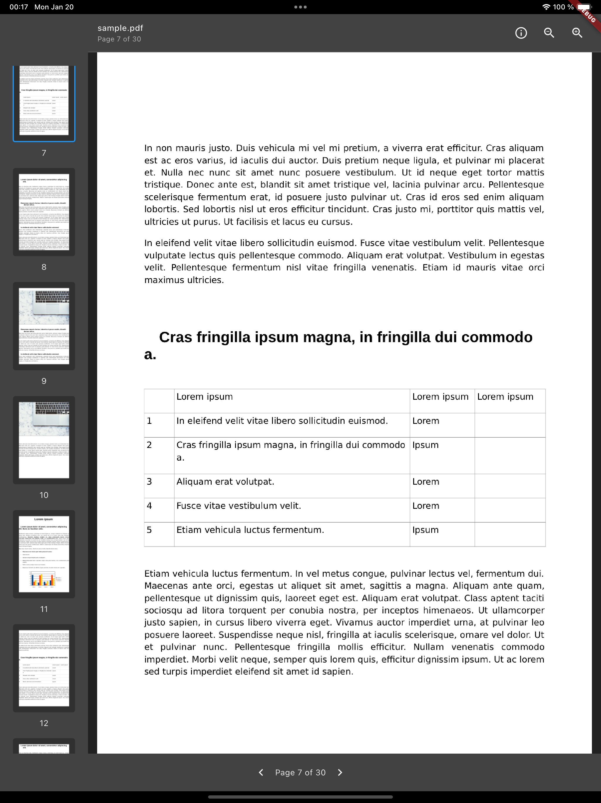
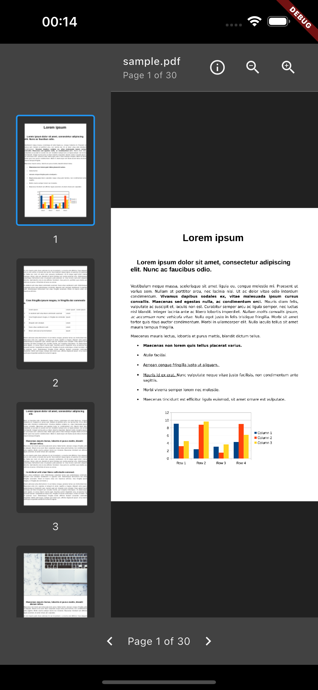
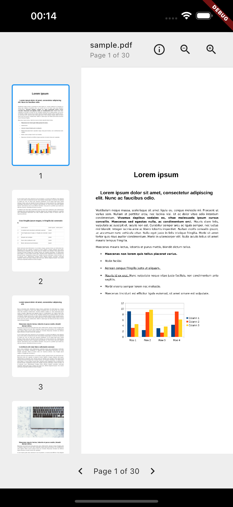

# Mini PDF & EPUB Viewer

**Mini PDF & EPUB Viewer** is a Flutter widget for reading PDF and EPUB documents. PDFs scroll continuously with sharp pinch and double-tap zoom, like the iOS reader, and EPUBs render as reflowable text with a table of contents. It is suited to document reader apps, e-book apps, or any Flutter project that needs to show documents.

## Examples
|  |  |
|:--------------------------------------------------:|:----------------------------------------------------------:|
| Mini PDF Viewer Example                            | Dark Mode Tablet Example                                    |

|  |  |
|:-----------------------------------------------------------:|:------------------------------------------------------------:|
| Dark Mode Mobile Example                                     | Light Mode Mobile Example                                    |

## Features

- **Multiple Document Sources**: Load documents from various sources:
  - Local files
  - Network URLs
  - Asset bundles
- **Continuous PDF Scrolling**: Pages scroll vertically on a canvas with drop shadows, rendered by [pdfrx](https://pub.dev/packages/pdfrx) (PDFium)
- **Sharp Zoom**: Pinch to zoom re-renders pages at the new resolution; double-tap zooms in and back to fit-to-width
- **Thumbnail Navigation**: A lazily rendered thumbnail sidebar that follows the current page
- **EPUB Reading**: Reflowable text one section at a time, embedded images, links between chapters, adjustable text size and a table of contents sidebar
- **Responsive Layout**: Adapts to different screen sizes and orientations
- **Error Handling**: Comprehensive error handling with user-friendly error messages and retry options
- **Loading States**: Clear loading indicators for both document and thumbnails
- **Custom Styling**: Customizable thumbnail sizes and selection colors

## Installation

Add this to your package's pubspec.yaml file:

```yaml
dependencies:
  mini_pdf_epub_viewer: ^0.2.0
```

## Usage

First, import the package:

```dart
import 'package:mini_pdf_epub_viewer/mini_pdf_epub_viewer.dart';
```

### Load a Local File

```dart
DocumentViewer(
  source: DocumentSource.file('/path/to/document.pdf'),
  type: DocumentType.pdf,
);
```

### Load from Network

```dart
DocumentViewer(
  source: DocumentSource.network(
    'https://example.com/document.pdf',
    headers: {'Authorization': 'Bearer token'}, // Optional headers
  ),
  type: DocumentType.pdf,
);
```

### Load from Assets

```dart
DocumentViewer(
  source: DocumentSource.asset('assets/document.pdf'),
  type: DocumentType.pdf,
);
```

### Load an EPUB

```dart
DocumentViewer(
  source: DocumentSource.asset('assets/book.epub'),
  type: DocumentType.epub,
);
```

EPUBs can be loaded from assets, files or the network in the same way as PDFs.

## Customization

The viewer can be customized with various properties:

```dart
DocumentViewer(
  source: DocumentSource.file('/path/to/document.pdf'),
  type: DocumentType.pdf,
  themeMode: ThemeMode.dark,
  thumbnailWidth: 200,
  showThumbnails: true,
  selectedThumbnailColor: Colors.blue,
  pageTransitionDuration: Duration(milliseconds: 300),
  pageTransitionCurve: Curves.easeInOut,
);
```

## Properties

| Property | Type | Default | Description |
|----------|------|---------|-------------|
| source | DocumentSource | required | Configuration for the document source |
| type | DocumentType | required | Type of document (PDF/EPUB) |
| thumbnailWidth | double | 200 | Width of the sidebar (PDF thumbnails or EPUB table of contents) |
| showThumbnails | bool | true | Whether to show the sidebar |
| selectedThumbnailColor | Color? | iOS system blue | Accent colour for the current page and controls |
| pageTransitionDuration | Duration | 300ms | Duration of page and section transitions |
| pageTransitionCurve | Curve | Curves.easeInOut | Curve for EPUB section transitions and sidebar scrolling |
| themeMode | ThemeMode? | system | Light or dark viewer, independent of the app theme |

## Maintainers

- [Davies Kwarteng](https://github.com/davies-k)

## License

```
MIT License

Copyright (c) 2025 Davies Kwarteng

Permission is hereby granted, free of charge, to any person obtaining a copy
of this software and associated documentation files (the "Software"), to deal
in the Software without restriction, including without limitation the rights
to use, copy, modify, merge, publish, distribute, sublicense, and/or sell
copies of the Software, and to permit persons to whom the Software is
furnished to do so, subject to the following conditions:

The above copyright notice and this permission notice shall be included in all
copies or substantial portions of the Software.

THE SOFTWARE IS PROVIDED "AS IS", WITHOUT WARRANTY OF ANY KIND, EXPRESS OR
IMPLIED, INCLUDING BUT NOT LIMITED TO THE WARRANTIES OF MERCHANTABILITY,
FITNESS FOR A PARTICULAR PURPOSE AND NONINFRINGEMENT. IN NO EVENT SHALL THE
AUTHORS OR COPYRIGHT HOLDERS BE LIABLE FOR ANY CLAIM, DAMAGES OR OTHER
LIABILITY, WHETHER IN AN ACTION OF CONTRACT, TORT OR OTHERWISE, ARISING FROM,
OUT OF OR IN CONNECTION WITH THE SOFTWARE OR THE USE OR OTHER DEALINGS IN THE
SOFTWARE.
```